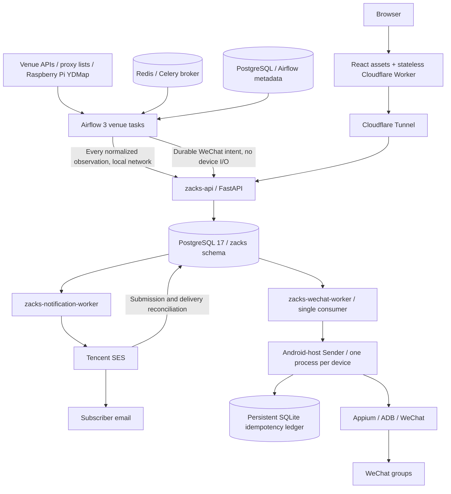

# Architecture: Host Core-only

Release implementation: 0.7.0 hardening, 2026-09-05. This describes the release
contract; only an accepted exact-commit production report establishes what is
live. See ADR 0013 and `docs/runbooks/host-core-cutover.md` for migration and
failure handling. No legacy runtime compatibility is supported.

## Delivery Control Plane

GitHub is the sole development-to-production control plane. Pull requests pass
`CI / verify`; protected production workflows receive scoped deployment
identities from the `production` Environment. Developers do not receive SSH,
Cloudflare, SES, device or database credentials. The Issue #39 owner-authorized
ship command installs one exact main commit and creates an immutable release
only after business acceptance. Temporary production schedulers are not used.

## Production Data Flow

## Durable ownership and boundaries

PostgreSQL schema `zacks` is the only durable business store. It holds verified
identities/receipts, tiers/roles/invites, subscriptions, venue relationships,
observation fingerprints/current availability, semantic events, email intents,
leases/attempts/quotas, delivery status, WeChat intents, cooldowns and migration
checkpoints. `runtime_control` holds durable activation, a fenced delivery switch,
deployment identity and acceptance evidence. Airflow Variables retain configuration
and bounded collector preclaim caches, not the authoritative notification queue.

The `zacks` schema and Airflow metadata currently share PostgreSQL 17 and the
host. Business migrations never alter Airflow metadata. Metadata cleanup must
exclude `zacks`. Shared host/database failure remains a common failure boundary;
this is not multi-host high availability. Redis is the Celery broker only: loss
can stop new collection, but must not erase subscriptions or durable outboxes.

## Identity and subscriptions

The React contract uses email verification and bearer receipts. Challenge and
system-email intent are written together; wrong-code counts commit even when the
API returns an error. Verification attempts and send-code rates are bounded.
Per-user transaction locks serialize active-subscription limits. Expired
non-renewing subscriptions become inactive before duplicate enforcement.
Cancellation takes the delivery fence, records the inactive subscription and
cancels pending mail. A send that already started is allowed to finish before
cancellation returns. Coffee claims serialize by identity and preserve the
five-second delay and 30-day invitation validity.

### Playing-date reminder preferences

`notification_date_pauses` stores one durable preference per verified email and
Asia/Shanghai playing date. Authenticated `GET /api/notification-pauses` returns
the active future/today dates and the server's calendar day; `POST` accepts
`{action: "pause" | "resume", dates: ["YYYY-MM-DD", ...]}`. Each atomic request
accepts 1–31 dates from today through today + 365 days and returns `changedDates`
for precise undo. Repeated operations are idempotent; clients cannot select the
target email. Resuming updates the preference instead of deleting its history.

Date changes take the exclusive delivery fence before touching preferences or
queues. Observation matching and subscriber claims take its shared counterpart
before row locks; final dispatch rechecks the preference while holding the
existing send guard. Pausing cancels only definitely-unsent subscriber intents
for the selected playing dates and releases their unused quota claims. It never
rewrites submitted, uncertain or delivered outcomes. Personal preferences do
not change venue crawling, subscriptions, WeChat group eligibility or system
emails.

On resume, the next fresh natural observation must have been checked after the
preference changed and still satisfy the current subscription/slot rules. Only
intents cancelled by this feature may requalify; their event dedupe key and
original `created_at` are retained, while `eligible_at` bounds the new delivery
window. Subscriber digests link to `/?pauseDate=YYYY-MM-DD`. That navigation only
preselects a date in My Subscriptions and requires an explicit authenticated
save. The same sheet handles verification return, multi-date selection, restore
and undo; inbound email reply commands are outside this release.

## Observation, matching and deduplication

Every natural poll reaches the local API, including unchanged availability.
Scope-level PostgreSQL locks serialize observations; older observations cannot
resurrect newer closed slots. Current availability is refreshed atomically and
unhealthy/empty observations clear that scope. Semantic fingerprints suppress
redundant matching but not freshness updates. Subscription generations cause
newly created subscriptions to be matched on the next natural poll even when
availability has not changed. Event/subscription/channel uniqueness prevents
repeated queue creation. Venue IDs, DAG IDs and retained task IDs remain stable.
Approved schedules are recorded in the schedule policy. Following the
2026-10-20 update, Shenzhen Bay polls every two minutes and Greater Bay Area
every three minutes, only from 08:00 inclusive to 21:00 exclusive in
Asia/Shanghai. Both venues inspect today and the next two calendar days;
Shenzhen Bay's fourth-day task was retired by explicit user request on
2026-10-20, retaining its historical run records. Their interval schedules
continue outside that window, but
intentional-idle rounds publish only an internal healthy empty observation to
refresh status and clear stale availability, without querying CRLand or
attempting reminders. Both venues share three CRLand accounts and rotate
independently by their own scheduled round; every date and booking-area query
in a venue round keeps the selected account. Actual local time is checked
before each upstream attempt and final publication, so closing the window
discards partial results and publishes the idle observation. The one-minute
default and other explicit exceptions remain in force.

Business acceptance retains the retired `szw:check_and_notify_day_3` scope
(approved 2026-10-20) and `baoti:check_tennis_courts` scope (approved 2026-11-01)
as historical evidence under the exact policies in `host-core-contract.yaml`.
The owner withdrew the Baoan integration, so `baoti` is absent from the 26
active venue producers and new subscription/delivery targets. Its catalog row,
existing subscriptions, observations, queue history and deduplication identities
remain durable. Schema fingerprints and seed identity retain the historical
27-row catalog; retirement performs no migration or deletion. Existing user
subscriptions remain visible and cancellable, with the retired selection labeled.

Only these approved scopes are exempt from ongoing scope health/freshness,
and only while the manifest excludes their retired producers. Every other
stored scope remains checked, and an empty active set fails. Venue acceptance
requires the exact 26 active IDs; missing, duplicate or unknown catalog entries
fail rather than being silently filtered. Reports retain original historical
rows and separate checked/retired counts. Email dispatch and WeChat eligibility
reject withdrawn venues without deleting or replaying their records. All active
venue natural cycles and real natural delivery receipts remain mandatory.

## Email delivery

Subscriber and system-email outboxes are separate. Workers lease with
`FOR UPDATE SKIP LOCKED`, reserve user/global daily quota and write an immutable
attempt before external I/O. Subscriber groups use actual booking dates and
current tiers. Weather gating is per booking day, with explicit priority bypass
and bounded forecast caching. Before dispatch, cancellation, current availability,
slot start, tier eligibility, intent age, and the subscriber's ideal window are
rechecked. A window mismatch cancels that unsent intent with
`ideal_window_changed` instead of expiring it. Changing the window takes the
exclusive delivery fence before the subscription lock, so the preference cannot
commit between that read and the dispatch update. Unsent `pending`, `retry`,
and `processing` mail outside the new window is cancelled and its unused quota
claim is released. A vendor call that already holds the shared fence finishes;
after the fence is free, still-unsubmitted `processing` rows can cancel.
Submitted mail, live provider attempts, and WeChat rows stay as they are.
PATCH does not put a cancelled ideal-window row back on the queue, because the
court may no longer be free. The next fresh observation restores only an unsent
`ideal_window_changed` row when the slot matches again and that playing date is
not paused. The original event key and `created_at` stay, and `eligible_at`
bounds the new delivery lifetime. Submitted, uncertain, expired, unsubscribed,
and rain-suppressed endings are not restored. Verification messages
expire with their challenge. Stale backlog is not blindly replayed.

Explicit pre-submission connection failures or provider rejection use bounded
retry. Ambiguous timeouts, process crashes or database failure after provider
acceptance become `submission_unknown`; retries cannot manufacture exactly-once
semantics across SES and PostgreSQL. Known provider IDs are reconciled with a
leased schedule and bounded backoff. `submitted` is not `delivered`; an expired
provider lookup window means unknown delivery, not proven failure.

## WeChat delivery

Venue tasks only persist intents through the local API. The dedicated host
consumer serializes work with a session advisory lock and stops if that lock
connection changes. It verifies active venue subscriptions, actual current slot
coverage, message validity and expiry before device dispatch. No stale remote
Cloudflare subscription gate participates. The Sender's readiness, exact commit
and durable ledger are checked before use. The ledger binds each idempotency key
to a payload hash and stores sent/uncertain outcomes across restarts. Known busy
conditions retry; unknown UI outcomes are quarantined, not replayed. PostgreSQL
owns per-group mini-program cooldowns and the host queue; the device ledger owns
the final device-side idempotency boundary.

Each group's first natural alert between 06:00 (inclusive) and 12:00 (exclusive),
Asia/Shanghai, ends with a short email-subscription guide to
`https://courts.zacks.vision/`. The host consumer checks durable outbox history
across all venues for that receiver, so a restart cannot repeat the daily guide.
An alert with this guide omits the venue booking mini-program link and does not
consume its cooldown. Other alerts retain the existing booking-link policy.
Known-unsent failures leave the guide eligible; uncertain submissions containing
it reserve that morning until reconciled. Retries recheck eligibility and remove
the guide after noon, restoring the booking link when its cooldown permits.
No separate promotional notification is scheduled, and a morning with no eligible
court alert sends no guide.

## Cloudflare boundary

The owner-authorized [remote operations plane](docs/runbooks/remote-operations-mcp.md)
adds separate Pi/VPS MCP applications and explicit operator groups. Privileged
shell operations require same-user browser confirmation of the exact command,
with audit hashes and no automatic replay. This is trusted-admin access, not a
shell sandbox. Repository releases remain protected GitHub-only. Cloudflare
frontend management uses the official API MCP with each collaborator's own
account permissions; management tokens are not copied into Pi/VPS hosts.
Operator membership remains in Cloudflare and is never overwritten by deploys.

An independent trusted-agent control endpoint is specified in
[ADR 0015](docs/adr/0015-pi-appium-mcp.md). It uses dedicated Cloudflare
Access owner-only managed OAuth for interactive agents, a dedicated machine
credential for protected automation, and a separate Tunnel to a loopback-only
Pi MCP process. OAuth uses the existing Cloudflare login provider, bounded
refresh grants and restricted callbacks, not a reused management token or an
account-wide phone-control policy. The connector validates the Access assertion
for both paths. It shares whole-phone locks with the Sender and device agent; it is
not part of the venue delivery pipeline and cannot attach to their Appium
sessions. Existing Appium 2 services are reused, not upgraded. This boundary
does not secure legacy public Appium routes automatically; those require a
separate caller inventory and approved restriction.

Cloudflare has no durable business ownership. The production Worker has no D1
binding, scheduled business work, migration endpoint or legacy backend import.
It serves React assets and proxies public APIs to the host through Tunnel, with
trusted-header sanitization and bounded timeouts. Public `/api/internal/*` routes
are not exposed. There is no automatic D1 fallback. An origin outage produces
an explicit 503, not stale success. D1 is retained unbound as a migration archive.
The one-time maintenance artifact exists only to freeze old writes and transfer
secrets before first activation; it never serves as a compatibility backend.

A Cloudflare/Tunnel outage can still prevent site access and subscription changes.
Existing durable mail and host-side matching do not use that edge. The acceptance
report additionally checks the actual Sender transport for Cloudflare proxying
before claiming that the complete WeChat path bypasses Cloudflare.

## Failure isolation and acceptance

Readiness checks dependency availability with meaningful HTTP status. Worker
health checks actual recent loop heartbeats, not merely a database connection.
Email and WeChat channel failures do not overwrite each other's outcome. A
PostgreSQL exclusive fence pauses delivery after in-flight calls finish. After
activation, deployments roll forward; old D1 snapshots cannot be reimported.
Backups and source exports remain root-only, never public workflow artifacts.

Acceptance has four distinct evidence classes:

1. Exact release identities and public HTTP health/bootstrap/security checks.
2. Production database/API logic, including date pause/list/restore, idempotency,
   anonymous denial and preservation of subscriptions, through an operator-only
   transaction probe; all test writes are rolled back and it sends no real
   email/WeChat. It is not a public browser or external verification-email test.
3. All 26 venue DAGs passing three natural cycles, fresh per-scope observations,
   healthy auxiliary tasks and advancing consumers/queues.
4. Real natural SES-delivered and WeChat-sent records after the release window.

Missing evidence is not a passing check. Only privacy-safe counts, venue/task
status, identity hashes and component commits appear in reports. Testing and
ordinary health checks never generate synthetic real notifications.

The machine-readable authorities are `active-components.yaml`,
`venue-schedule-policy.yaml`, `runtime-target.yaml` and `host-core-contract.yaml`.
