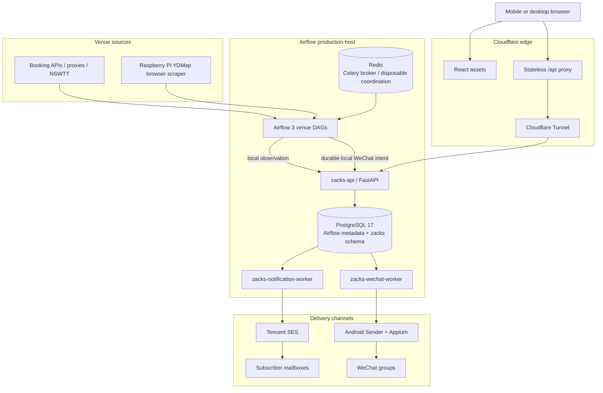

# 🎾 WeChat-on-Airflow

> Shenzhen tennis availability alerts: Apache Airflow 3 performs high-frequency venue polling, a PostgreSQL-backed notification core on the Airflow host owns subscriptions and email, and Cloudflare is reduced to the public edge.

[English](./README.en.md) · [中文](./README.md)

[](https://github.com/claude89757/wechat-on-airflow/actions/workflows/ci.yml)
[](https://www.python.org/)
[](https://airflow.apache.org/)
[](https://www.postgresql.org/)
[](LICENSE)

## ✨ Features

- **Multi-venue polling**: 27 Shenzhen venue DAGs. Shenzhen Bay polls every two minutes and Greater Bay Area every three minutes, from 08:00 inclusive to 21:00 exclusive in Asia/Shanghai. Three CRLand accounts rotate independently by each venue's scheduled round. Dashah International and Bao'an Tennis Center share a single-slot browser pool and poll every two minutes. Other venues use the one-minute default or an explicit policy exception.
- **Host-owned subscription core**: local `zacks-api` accepts observations and Web requests; PostgreSQL schema `zacks` stores identities, subscriptions, dedupe state, Outboxes, quotas, and delivery results.
- **Subscriber email**: `zacks-notification-worker` performs matching, digesting, tier limits, weather policy, Tencent SES submission, retries, and delivery reconciliation.
- **WeChat alerts**: venue tasks only write durable WeChat intents. The separate `zacks-wechat-worker` calls the Android Sender, and device-side durable idempotency avoids duplicate sends after a restart.
- **Stateless Cloudflare edge**: the Worker serves React assets and proxies `/api/*` without business state. After cutover, D1 has no runtime binding and remains only a migration archive, never a compatibility backend.
- **Failure isolation**: a Cloudflare or D1 failure does not stop email or WeChat for existing subscriptions. Redis loss cannot lose or duplicate a notification. A failure in one delivery channel does not contaminate the other.
- **Exact-commit releases**: GitHub Actions is the only production control plane and verifies the deployed SHA across all affected runtimes.
- **Complete quality gate**: `make verify` covers Ruff, mypy, Python tests, Web/Worker tests, browser regression, Compose, images, and Airflow DagBag contracts.

## 🏗️ Architecture



### Core principles

1. **PostgreSQL is the only durable business source of truth.** It owns users, subscriptions, venue status, event identities, notification Outboxes, daily limits, and provider status.
2. **Redis is not authoritative.** It remains the Celery broker and may provide wake-ups or hot cache entries, but notification correctness never depends on Redis persistence.
3. **Exactly one email owner is active.** The first activation freezes the previous owner, imports and verifies the data, then lets the host worker own delivery. There is no dual-write path and no legacy runtime fallback.
4. **WeChat does not depend on Cloudflare.** The separate WeChat worker decides delivery from PostgreSQL subscriptions and current availability. Venue DAGs do not wait for the device send.
5. **Cloudflare is only the edge.** It serves static assets, TLS/WAF, stateless API forwarding, and Tunnel ingress. It does not query D1, run a notification Cron, or own a notification decision.
6. **Failure pauses delivery and rolls forward.** The first cutover uses a maintenance window, encrypted secret transfer, bulk import, and per-table verification. After activation, D1 is not imported again, the old path is not restored automatically, and the original business data is not deleted.

Current production status is established only by an exact-commit acceptance report from the protected workflow. This page does not by itself show that migration is complete. Acceptance includes three natural inspection cycles for all 27 venues, the production transaction-rollback subscription probe, and real natural email and WeChat delivery records.

See [ARCHITECTURE.md](./ARCHITECTURE.md) and [ADR 0013](./docs/adr/0013-host-core-only-reliable-delivery.md).

## 🧱 Tech Stack

| Component | Role |
| --- | --- |
| Apache Airflow 3.3.0 (CeleryExecutor) | Venue polling, scheduling, and orchestration |
| Python 3.12 | Venue adapters, API, migration, and notification worker |
| PostgreSQL 17 | Airflow metadata plus the isolated `zacks` business schema |
| Redis | Celery broker and optional disposable coordination |
| FastAPI + Uvicorn | Local subscription and observation API |
| Tencent SES | Verification, lifecycle, and subscriber email |
| Android + Appium (systemd) | WeChat group sender |
| React + Cloudflare Worker | Static Web application and stateless edge proxy |
| Cloudflare Tunnel | Secure public ingress for Airflow and `zacks-api` |

Public endpoints: Airflow console `https://airflow.claude89757.cc` · subscription site `https://zacks.claude89757.cc`

## 📁 Repository Layout

```text
├── dags/                              # Production DAG wiring only
├── pi_host/                           # Raspberry Pi YDMap browser scraper
├── src/wechat_airflow/
│   ├── venues/                        # Venue APIs, parsing, filtering
│   ├── host_core/                     # PostgreSQL API, matching, migration, email worker
│   ├── notifications/                 # Observation compatibility and WeChat clients
│   ├── proxy_tools/                   # Proxy refresh
│   └── maintenance/                   # Android maintenance
├── webapp/
│   ├── src/                           # React client
│   └── cloudflare/                    # Stateless edge and migration compatibility
├── config/
│   ├── active-components.yaml
│   ├── runtime-target.yaml
│   └── host-core-contract.yaml
├── scripts/                           # Idempotent development and production operations
├── docker/                            # Reproducible runtime images
├── docs/                              # ADRs, runbooks, architecture, evidence
└── tests/                             # Unit, contract, migration, browser, DagBag tests
```

## 🚀 Quick Start

Requires Python 3.12, Node 24, and Docker Compose v2:

```bash
make setup
make local-secrets
make verify
```

Tests, CI, and normal health checks **never** send real email or WeChat messages.

The local Compose runtime includes:

```text
postgresql
redis
airflow-api-server
airflow-scheduler
airflow-dag-processor
airflow-worker
airflow-triggerer
zacks-api
zacks-notification-worker
zacks-wechat-worker
```

The initial production transition must use the protected `Production Host Core` workflow and the [host-core cutover runbook](./docs/runbooks/host-core-cutover.md). It must not be replaced with an ordinary Web deployment.

## 📖 Documentation

| Document | Purpose |
| --- | --- |
| [ARCHITECTURE.md](./ARCHITECTURE.md) | Current architecture and failure boundaries |
| [AGENTS.md](./AGENTS.md) | Repository operating and safety invariants |
| [config/host-core-contract.yaml](./config/host-core-contract.yaml) | Machine-readable host-core ownership contract |
| [docs/adr/0012-airflow-host-notification-core.md](./docs/adr/0012-airflow-host-notification-core.md) | Architecture decision and migration principles |
| [docs/runbooks/host-core-cutover.md](./docs/runbooks/host-core-cutover.md) | Shadow migration, cutover, verification, rollback |
| [docs/release-strategy.md](./docs/release-strategy.md) | Exact-commit release strategy |
| [SECURITY.md](./SECURITY.md) | Security policy |

## 🔐 Configuration and Security

- The protected GitHub Environment stores deployment identities, not business state.
- Airflow Variables store venue configuration and emergency switches, not growing business history.
- PostgreSQL schema `zacks` stores all durable application state.
- Tencent SES credentials live in root-owned host Secret files. During migration they are transferred directly through an ephemeral RSA-OAEP/AES-GCM envelope; GitHub never receives plaintext.
- Cloudflare Worker secrets keep only the values the previous owner needs during the migration window. After cutover, the edge API uses only the reverse-proxy authentication token.
- Deleting D1, cleaning business data, rotating secrets, and replacing a database are separate high-risk operations. This cutover does not perform them.

## 🤝 Contributing

See [CONTRIBUTING.md](./CONTRIBUTING.md), [SECURITY.md](./SECURITY.md), and [CODE_OF_CONDUCT.md](./CODE_OF_CONDUCT.md).

## 📄 License

MIT License. See [LICENSE](./LICENSE).
